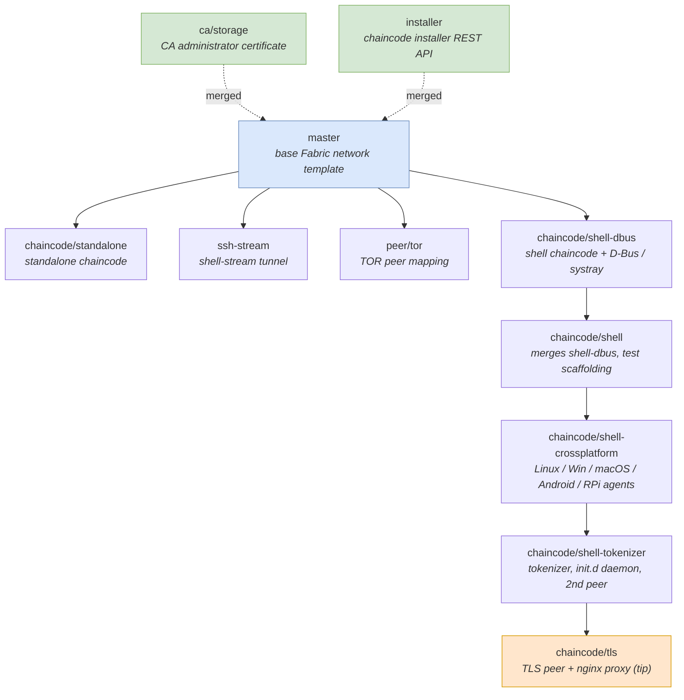

# Branch map

This diagram shows how the project's branches relate to `master` and to each
other. `master` is the base single-organization Hyperledger Fabric network
template. `ca/storage` and `installer` have been merged back into `master`; the
remaining branches form one evolving feature line (the `shell` agent) plus a few
side explorations.

## Legend

- **Blue** — `master`, the base network template.
- **Green (dashed)** — branches already merged into `master`.
- **Orange** — `chaincode/tls`, the tip of the mainline (most complete).

## Lineage summary

- Mainline: `master -> shell-dbus -> shell -> shell-crossplatform -> shell-tokenizer -> tls`.
- Side branches off `master`: `chaincode/standalone`, `ssh-stream`, `peer/tor`.
- Merged into `master`: `ca/storage`, `installer`.
