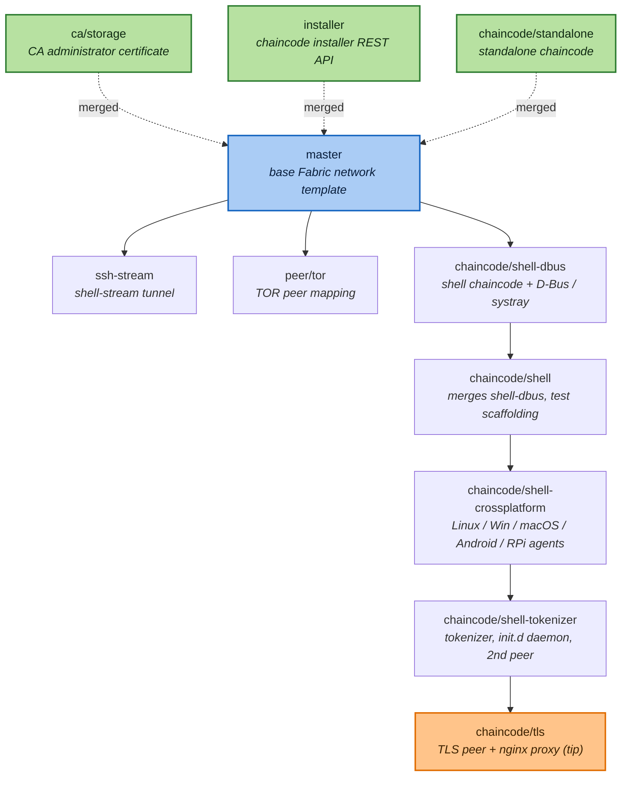

# Branch map

This diagram shows how the project's branches relate to `master` and to each
other. `master` is the base single-organization Hyperledger Fabric network
template. `ca/storage` and `installer` have been merged back into `master`; the
remaining branches form one evolving feature line (the `shell` agent) plus a few
side explorations.



## Legend

- **Blue** — `master`, the base network template.
- **Green (dashed)** — branches merged into `master`.
- **Orange** — `chaincode/tls`, the tip of the mainline (most complete).

## Lineage summary

- Mainline: `master -> shell-dbus -> shell -> shell-crossplatform -> shell-tokenizer -> tls`.
- Side branches off `master`: `ssh-stream`, `peer/tor`.
- Merged into `master`: `ca/storage`, `installer`, `chaincode/standalone`.

## Merge policy

Only the **non-offensive** branches are merged into `master`: the base Fabric
network, `ca/storage` (standard CA administrator certificate), `installer` (the
chaincode-installer REST API), and `chaincode/standalone` (a benign sample
chaincode whose `Invoke` merely echoes the requested function name).

## Branches that cannot be merged

The branches below are intentionally **left unmerged** and must not be merged
into `master`. Individually some pieces are dual-use; taken together they form a
working remote-access / command-and-control (C2) system delivered over
Hyperledger Fabric: arbitrary remote command execution, anonymized transport,
certificate-verification bypass, self-installing cross-platform persistence, and
script obfuscation. Merging them into `master` would assemble that capability in
one tree, and there is no authorization context (owned lab, named engagement) on
record for building or running it. Each entry records the specific reason.

### `chaincode/shell-dbus`, `chaincode/shell` — ledger-driven command execution

The shell chaincode's `Invoke` takes a command out of the ledger transaction and
runs it on the host shell:

```go
// chaincodes/shell/shell.go
cmd := exec.Command("bash", "-c", command)   // executes arbitrary attacker-supplied input
```

Anyone able to submit a transaction to the channel gains arbitrary command
execution on every node running the agent. The D-Bus/systray additions only
surface a desktop notification while a remote command runs. **Reason: remote
code execution by design — this is the core offensive capability.**

### `chaincode/shell-crossplatform` — packaged cross-platform agents

Rebuilds the shell agent as prebuilt binaries committed to the repo for Linux,
Linux-DBus, Windows (`.exe`), macOS, Android and Raspberry Pi
(`chaincodes/shell-*/shell-*`). **Reason: turns the RCE chaincode into a
ready-to-drop, multi-platform agent; the checked-in opaque binaries are also
unreviewable.**

### `chaincode/shell-tokenizer` — persistence + obfuscation + external endpoint

Builds on the agents with three additional traits:

- **Persistence.** `start.tpl.sh` is an `### BEGIN INIT INFO ###` init.d service
  that installs the agent as a boot-time daemon which loads its target
  `PEER_ADDRESS`/`CHAINCODE_ID_NAME` from the environment and auto-reconnects.
- **Obfuscation + external call-out.** `Invoke` now runs commands through
  `exec.Command("./eval.sh", command)`, and the template exports
  `TOKENIZER_ENDPOINT=http://softethica.com:3007/keyChain/password`, routing
  script content through an external third-party endpoint.
- Ships a `tokenizer` binary for every platform and checked-in
  `configtxgen`/`cryptogen` binaries.

**Reason: adds boot persistence, script obfuscation, and an external network
dependency on top of the RCE agent.**

### `ssh-stream` — host shell tunnel

Adds a `host-shell0.org1.example.com` container (`vitche/docker-host-shell-tunnel`)
and `tunnel.sh`/`worker.sh` that bind-mount FIFOs
(`/tmp/docker-host-shell-tunnel-{input,output}.fifo`) from the host into the
container and pipe a host shell through a chaincode. **Reason: provides an
interactive shell tunnel from the ledger to the Docker host, breaking container
isolation.**

### `peer/tor` — anonymized transport

Adds a `peer0.org1.example.onion` container (`vitche/docker-tor-mapping`) that
re-exposes peer ports 7052/7053 over TOR. **Reason: anonymizes the agent's
command/control channel; legitimate for privacy research, but combined with the
shell agent it is the covert transport for a C2.**

### `chaincode/tls` — certificate-verification bypass

The branch's own `documentation/chaincode-tls.md` instructs patching the Fabric
shim to disable verification:

```diff
 return credentials.NewTLS(&tls.Config{
+    InsecureSkipVerify: true,
     Certificates: []tls.Certificate{cert},
```

It pairs this with an nginx `stream {}` TLS-terminating proxy
(`nginx/nginx.conf`) in front of a second peer. **Reason: deliberately defeats
TLS certificate validation (enabling undetected man-in-the-middle), which must
never land on `master`.**

## Tests

`chaincodes/standalone/` carries a Go unit test (`standalone_test.go`) covering
`Init` and `Invoke`. Because the Fabric 1.4 shim predates Go modules, the test
compiles against a small local shim double under `testshim/` (the `go.mod` there
is test-only and ignored by the real GOPATH-mode chaincode build). Run it in
Docker:

```sh
docker run --rm -v "$PWD/chaincodes/standalone:/w" -w /w golang:1.21 go test ./... -v
```
