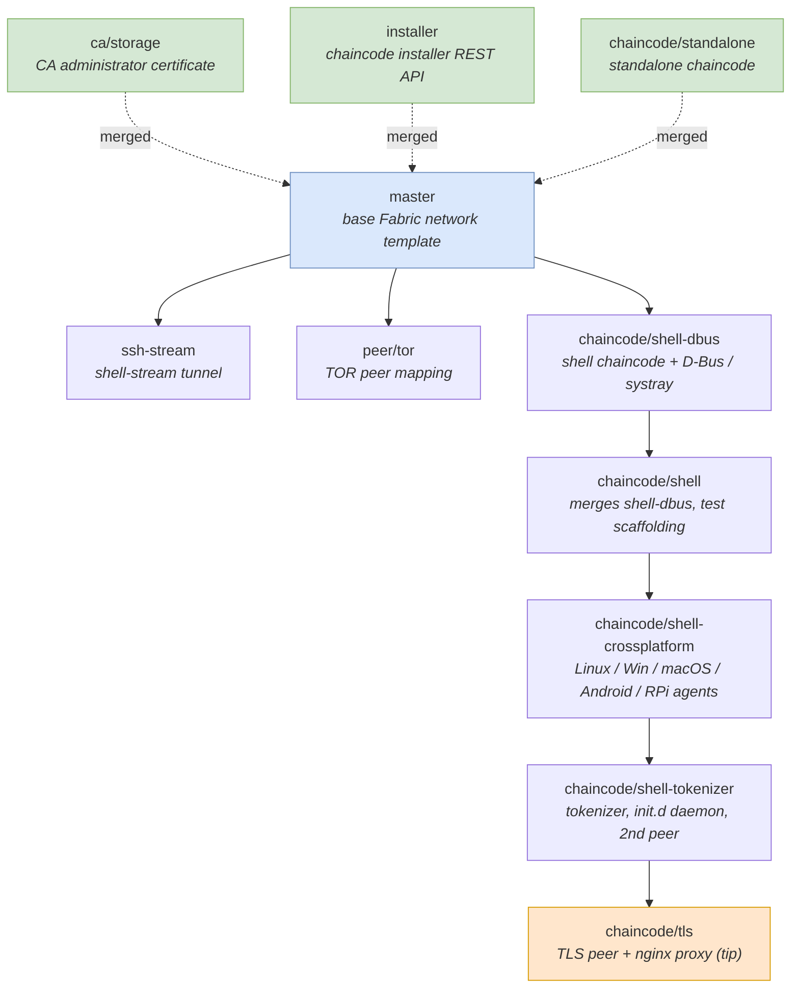

# Branch map

This diagram shows how the project's branches relate to `master` and to each
other. `master` is the base single-organization Hyperledger Fabric network
template. `ca/storage` and `installer` have been merged back into `master`; the
remaining branches form one evolving feature line (the `shell` agent) plus a few
side explorations.



## Legend

- **Blue** — `master`, the base network template.
- **Green (dashed)** — branches merged into `master`.
- **Orange** — `chaincode/tls`, the tip of the mainline (most complete).

## Lineage summary

- Mainline: `master -> shell-dbus -> shell -> shell-crossplatform -> shell-tokenizer -> tls`.
- Side branches off `master`: `ssh-stream`, `peer/tor`.
- Merged into `master`: `ca/storage`, `installer`, `chaincode/standalone`.

## Merge policy

Only the **non-offensive** branches are merged into `master`: the base Fabric
network, `ca/storage` (standard CA administrator certificate), `installer` (the
chaincode-installer REST API), and `chaincode/standalone` (a benign sample
chaincode whose `Invoke` merely echoes the requested function name).

The remaining branches are intentionally **left unmerged**. Together they build a
ledger-driven remote-shell / remote-administration agent, and consolidating or
running them is out of scope here:

- `chaincode/shell-dbus`, `chaincode/shell`, `chaincode/shell-crossplatform`,
  `chaincode/shell-tokenizer` — chaincode that executes arbitrary `bash -c`
  commands from the ledger, packaged as self-installing cross-platform agents
  with script obfuscation.
- `ssh-stream` — host shell tunneling through a chaincode.
- `peer/tor` — TOR anonymization of peer connectivity.
- `chaincode/tls` — a TLS setup that disables certificate verification
  (`InsecureSkipVerify`).

## Tests

`chaincodes/standalone/` carries a Go unit test (`standalone_test.go`) covering
`Init` and `Invoke`. Because the Fabric 1.4 shim predates Go modules, the test
compiles against a small local shim double under `testshim/` (the `go.mod` there
is test-only and ignored by the real GOPATH-mode chaincode build). Run it in
Docker:

```sh
docker run --rm -v "$PWD/chaincodes/standalone:/w" -w /w golang:1.21 go test ./... -v
```
